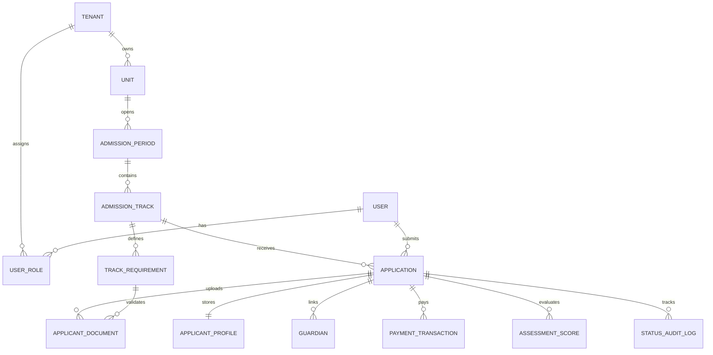

# 02. Arsitektur Netral & Model Domain

## 1. Prinsip Desain: *Netral di Inti, Fleksibel di Permukaan*

Untuk menghindari duplikasi logika antara aturan **SPMB**, **PMBM**, dan **Mandiri/Swasta**, seluruh skema database dan kode backend menggunakan **istilah domain yang netral**, sementara lapisan antarmuka (*UI Layer*) merender label sesuai konfigurasi masing-masing *tenant*.

### Pemetaan Terminologi

| Entitas Inti (Backend & DB) | Preset SPMB (Sekolah Umum) | Preset PMBM (Madrasah) | Preset Mandiri (Swasta / Pesantren) |
| :--- | :--- | :--- | :--- |
| `Tenant` | Sekolah / Penyelenggara | Madrasah / Penyelenggara | Yayasan / Sekolah / Pesantren |
| `Unit` | Jenjang Sekolah (SD/SMP/SMA/SMK) | Jenjang Madrasah (RA/MI/MTs/MA) | Unit Pendidikan / Lembaga |
| `AdmissionPeriod` | SPMB Tahun Ajaran | PMBM Tahun Pelajaran | Gelombang Pendaftaran (Gel. 1–3) |
| `AdmissionTrack` | Jalur (Domisili, Afirmasi, Prestasi, Mutasi) | Jalur (Reguler, Prestasi, Afirmasi, Khusus) | Jalur (Reguler, Beasiswa, Asrama, Tahfidz) |
| `Applicant` | Calon Murid | Calon Murid / Peserta Didik | Calon Murid / Calon Santri |
| `Guardian` | Orang Tua / Wali | Orang Tua / Wali | Orang Tua / Wali Santri |
| `RequirementRule` | Syarat Berkas & Usia | Syarat Berkas & Usia | Syarat Administrasi & Tes |
| `SelectionStage` | Seleksi Administrasi & Pemeringkatan | Seleksi Berkas / Tes / Wawancara | Ujian Masuk, BTQ & Wawancara |
| `Enrollment` | Daftar Ulang | Daftar Ulang | Daftar Ulang & Administrasi Awal |

---

## 2. Hierarki Multi-Tenant & Multi-Unit

Platform mendukung lembaga tunggal maupun yayasan yang menaungi beberapa jenjang sekaligus dalam satu portal terpadu:

```text
Platform (Super Admin)
└── Tenant (Sekolah Tunggal / Yayasan / Pesantren)
    ├── Tenant Settings (Branding, Custom Domain, Preset Istilah, Integrasi WA/PG)
    └── Unit / Jenjang (bisa 1 atau banyak, misal: MI, MTs, MA)
        └── Admission Period (contoh: TA 2026/2027 - Gelombang 1)
            ├── Admission Track (contoh: Jalur Prestasi, Jalur Domisili, Jalur Reguler)
            │   ├── Requirement Rules (daftar berkas wajib/opsional & validasi khusus)
            │   ├── Fee Config (biaya formulir & biaya daftar ulang, bisa Rp 0 / nonaktif)
            │   └── Scoring & Quota Config (kuota, bobot nilai/jarak, aturan limpahan)
            └── Applications (Data pendaftaran calon murid)
```

---

## 3. Mesin Aturan Modular (*Toggleable Stages & Dynamic Forms*)

Setiap **Periode (`AdmissionPeriod`)** atau **Jalur (`AdmissionTrack`)** memiliki sakelar (*feature toggles*) yang menentukan tahapan mana yang aktif:

1. **Toggle Biaya Pendaftaran (`registration_fee_enabled`):**
   * Jika `false` (misalnya sekolah negeri atau program gratis), sistem otomatis melewati tahap `AWAITING_PAYMENT` langsung menuju pengisian formulir.
   * Jika `true`, sistem mendukung tarif berbeda per gelombang atau per jalur (misal: potongan *Early Bird* atau gratis khusus jalur Afirmasi).
2. **Toggle Jenis Seleksi (`selection_mode`):**
   * `RULE_BASED`: Peringkat dihitung otomatis dari komponen aturan (jarak koordinat domisili, usia, nilai rapor, atau skor sertifikat prestasi).
   * `TEST_BASED`: Mengaktifkan pembuatan nomor & kartu ujian, penjadwalan sesi tes/wawancara, serta input nilai penguji.
   * `HYBRID`: Gabungan verifikasi aturan/nilai rapor dengan tes wawancara atau tes keagamaan (umum dipakai di PMBM & Pesantren).
   * `DIRECT_ACCEPTANCE`: Diterima langsung setelah berkas terverifikasi selama kuota tersedia (*first-come, first-served*).
3. **Formulir & Berkas Dinamis Per Jalur:**
   * **Jalur Domisili:** Memunculkan field titik koordinat rumah (peta) + tanggal terbit Kartu Keluarga.
   * **Jalur Afirmasi:** Memunculkan field nomor kartu bantuan sosial (KIP/PKH/DTKS) + unggah bukti.
   * **Jalur Prestasi:** Memunculkan tabel riwayat prestasi/piagam (tingkat kabupaten/provinsi/nasional) untuk konversi poin.
   * **Jalur Pesantren / Asrama:** Memunculkan preferensi asrama, ukuran seragam, dan riwayat kesehatan/hafalan.
4. **Aturan Limpahan Kuota (*Quota Spillover*):**
   * Mendukung kebijakan pengalihan sisa kuota dari satu jalur yang tidak terpenuhi (misalnya Jalur Mutasi atau Afirmasi) ke jalur lain (misalnya Domisili/Reguler) saat proses penetapan kelulusan.

---

## 4. Model Data Konseptual (ERD)



### Ringkasan Entitas Inti

* **`TENANT`**: Identitas pelanggan SaaS (nama instansi, tipe: sekolah/madrasah/yayasan, domain/subdomain, tema warna, preset terminologi, konfigurasi integrasi).
* **`UNIT`**: Satuan pendidikan di bawah tenant (jenjang: RA/TK, SD/MI, SMP/MTs, SMA/MA/SMK, NPSN/NSM).
* **`ADMISSION_PERIOD`**: Tahun ajaran & gelombang pendaftaran beserta rentang tanggal buka, verifikasi, seleksi, pengumuman, dan daftar ulang.
* **`ADMISSION_TRACK`**: Jalur penerimaan, daya tampung (*quota*), aturan biaya, mode seleksi, dan skema formulir tambahan.
* **`APPLICATION`**: Entitas transaksi pendaftaran (nomor pendaftaran unik, `current_status`, skor akhir, status kelulusan).
* **`APPLICANT_PROFILE` & `GUARDIAN`**: Biodata inti pendaftar dan orang tua/wali yang dipetakan mengikuti standar data nasional.
* **`APPLICANT_DOCUMENT`**: Metadata dokumen yang diunggah beserta status verifikasi per dokumen (`PENDING`, `APPROVED`, `REJECTED_FOR_REVISION`) dan catatan verifikator.
* **`PAYMENT_TRANSACTION`**: Catatan tagihan & pembayaran (biaya formulir dan biaya daftar ulang), mendukung metode otomatis (Payment Gateway) maupun verifikasi manual.
* **`ASSESSMENT_SCORE`**: Komponen nilai (jarak, usia, rapor, prestasi, tes tulis, wawancara/BTQ) beserta bobot dan total skor.
* **`STATUS_AUDIT_LOG`**: Jejak audit setiap perubahan status, revisi, perubahan nilai, atau penetapan kelulusan.

---

## 5. Standarisasi Data Nasional (*Dapodik & EMIS Ready*)

Agar hasil pendaftaran tidak perlu diinput ulang secara manual oleh operator sekolah setelah murid diterima, entitas `APPLICANT_PROFILE` dan `GUARDIAN` wajib mengakomodasi field standar **Kemendikdasmen (Dapodik)** dan **Kemenag (EMIS)**:

* **Identitas Anak:** Nama lengkap sesuai Akta, NIK (16 digit validasi format), Nomor KK, NISN (10 digit), tempat & tanggal lahir, jenis kelamin, agama, kewarganegaraan, status anak dalam keluarga, anak ke-, jumlah saudara, serta penanda Kebutuhan Khusus (Disabilitas).
* **Alamat Standar Wilayah:** Alamat jalan, RT/RW, Dusun, Kelurahan/Desa, Kecamatan, Kabupaten/Kota, Provinsi (berbasis kode wilayah standar), kode pos, serta koordinat lintang/bujur (*latitude/longitude*).
* **Data Pendidikan Sebelumnya:** Nama sekolah/madrasah asal, NPSN/NSM asal, tahun lulus, nomor seri ijazah/SKL (jika sudah terbit).
* **Data Orang Tua / Wali:** Nama lengkap, NIK, tahun lahir, pendidikan terakhir, pekerjaan, dan penghasilan (mengikuti rentang kategori standar Dapodik/EMIS), serta nomor WhatsApp aktif.
* **Layanan Ekspor:** Preset kolom ekspor Excel/CSV terpisah untuk **Template Import Dapodik** dan **Template Import EMIS**, ditambah opsi ekspor umum yang dapat dipilih kolomnya oleh admin sekolah.

