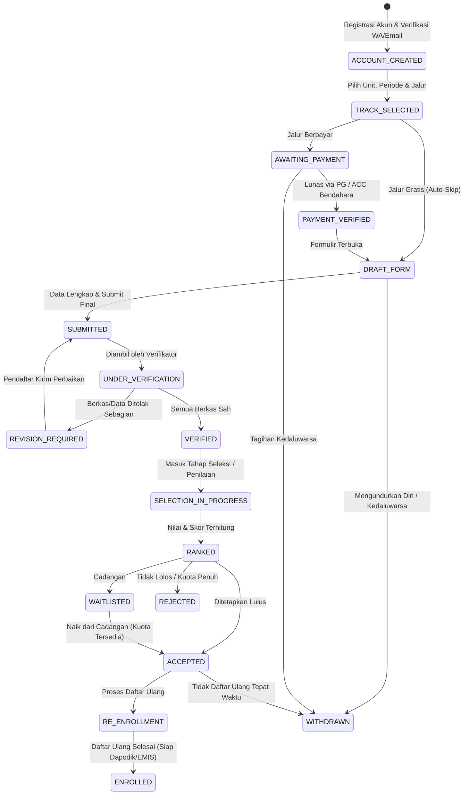

# 03. Alur Pendaftaran (*Flow*) & *State Machine*

## 1. Filosofi Alur

Alur pendaftaran dirancang agar **tegas bagi sistem, mudah dipahami orang tua, dan ringan bagi panitia**:
* Tidak ada status ganda atau membingungkan: setiap pendaftar berada pada tepat satu status utama di *state machine*.
* **Tahap opsional dilewati otomatis:** jika biaya formulir Rp 0 atau tanpa ujian masuk, pendaftar langsung melompat ke tahap berikutnya tanpa langkah kosong.
* **Revisi terarah:** jika berkas kurang jelas, panitia menandai dokumen spesifik saja agar pendaftar cukup memperbaiki dokumen tersebut tanpa mengulang seluruh formulir.

---

## 2. Diagram *State Machine* Pendaftaran

---

## 3. Penjelasan Detail Tiap Tahapan

### Tahap 1: Portal Publik & Pra-Pendaftaran
* Pengunjung melihat halaman beranda sekolah/yayasan: informasi jadwal gelombang, syarat tiap jalur, ringkasan daya tampung/sisa kuota *(opsional dapat disembunyikan oleh admin)*, alur pendaftaran, dan FAQ.
* Tersedia fitur **Cek Status Pendaftaran** cepat menggunakan nomor pendaftaran atau nomor HP/NISN (dengan informasi non-sensitif).

### Tahap 2: Pembuatan Akun & Pemilihan Jalur (`ACCOUNT_CREATED` → `TRACK_SELECTED`)
* Orang tua/calon murid membuat akun menggunakan nomor WhatsApp aktif (prioritas verifikasi OTP) atau email.
* Satu akun wali dapat mendaftarkan lebih dari satu anak (sangat berguna untuk yayasan multi-unit).
* Pendaftar memilih **Unit/Jenjang**, **Periode/Gelombang**, dan **Jalur Pendaftaran**.
* Sistem memeriksa syarat dasar awal secara langsung (misalnya batas usia minimal/maksimal per jenjang pada tanggal referensi 1 Juli tahun berjalan).

### Tahap 3: Pembayaran Formulir *(Opsional)* (`AWAITING_PAYMENT` → `PAYMENT_VERIFIED`)
* Hanya muncul jika jalur mengaktifkan biaya pendaftaran.
* **Otomatis (Payment Gateway):** Sistem menerbitkan kode QRIS / Virtual Account berbatas waktu; status berubah otomatis setelah *webhook* diterima.
* **Manual (Verifikasi Bendahara):** Pendaftar mentransfer ke rekening sekolah dan mengunggah bukti bayar; bendahara memverifikasi di panel keuangan.
* Jika jalur **Gratis**, sistem otomatis melompat ke tahap `DRAFT_FORM`.

### Tahap 4: Pengisian Biodata & Unggah Berkas (`DRAFT_FORM` → `SUBMITTED`)
* Formulir dibagi menjadi beberapa langkah ringkas (*multi-step wizard*) dengan **auto-save** agar pengisian dari ponsel tetap aman jika koneksi terputus:
  1. Biodata Calon Murid (disesuaikan standar Dapodik/EMIS).
  2. Data Orang Tua / Wali.
  3. Alamat & Koordinat Domisili (menampilkan peta interaktif untuk akurasi jarak pada jalur Domisili).
  4. Riwayat Pendidikan Asal & Prestasi *(jika memilih Jalur Prestasi)*.
  5. Unggah Berkas Persyaratan (KK, Akta Lahir, Pas Foto, KIP/PKH, Piagam — daftar berkas muncul dinamis sesuai jalur).
* Sebelum melakukan **Submit Final**, pendaftar melihat layar ringkasan untuk memeriksa ulang data.

### Tahap 5: Verifikasi Berkas & Siklus Revisi (`UNDER_VERIFICATION` ↔ `REVISION_REQUIRED` → `VERIFIED`)
* Panitia verifikator membuka antrean pendaftar `SUBMITTED`.
* Setiap dokumen memiliki status independen:
  * **Sah / Disetujui**
  * **Perlu Perbaikan** *(wajib isi catatan alasan, misal: "Foto KK terpotong di bagian tanggal terbit")*
* Jika ada minimal satu dokumen ditolak, status aplikasi menjadi `REVISION_REQUIRED` dan pendaftar menerima notifikasi WhatsApp/Email berisi daftar berkas yang perlu diperbaiki.
* Pendaftar hanya mengedit bagian yang ditandai merah lalu mengirim ulang. Setelah semua sah, status berubah menjadi `VERIFIED` dan sistem menerbitkan **Kartu Peserta / Bukti Verifikasi**.

### Tahap 6: Seleksi & Penilaian (`SELECTION_IN_PROGRESS` → `RANKED`)
Perilaku tahap ini mengikuti konfigurasi `selection_mode` pada jalur terkait:
* **Mode Berbasis Aturan (SPMB):**
  * Menghitung jarak garis lurus (*Haversine*) atau jarak rute dari koordinat rumah ke titik sekolah.
  * Mengurutkan prioritas berdasarkan aturan jalur (misalnya: jarak terdekat, usia tertua jika jarak sama, atau total poin prestasi/nilai rapor).
* **Mode Berbasis Tes / Wawancara (PMBM / Swasta / Pesantren):**
  * Sistem mengalokasikan jadwal ruangan/sesi tes atau wawancara (offline/online).
  * Tim penguji menginput nilai (Tes Akademik, BTQ/Keagamaan, Psikotes, Wawancara Orang Tua) pada panel khusus penguji.
* Admin dapat melihat **Simulasi Peringkat Sementara** serta mengeksekusi aturan **limpahan sisa kuota** sebelum hasil dikunci.

### Tahap 7: Penetapan & Pengumuman Kelulusan (`ACCEPTED` / `WAITLISTED` / `REJECTED`)
* Admin bersama Pimpinan/Kepala Sekolah menyetujui daftar kelulusan final.
* Status kelulusan bersifat **terjadwal (*Scheduled Release*)**: hasil tidak bocor ke publik sebelum jam & tanggal pengumuman resmi tiba.
* Pendaftar yang berstatus `WAITLISTED` (Cadangan) dapat dinaikkan menjadi `ACCEPTED` jika ada pendaftar utama yang mengundurkan diri atau melewati batas waktu daftar ulang.

### Tahap 8: Daftar Ulang & Penetapan Murid (`RE_ENROLLMENT` → `ENROLLED`)
* Pendaftar yang lulus melakukan konfirmasi kesediaan masuk, mengisi kelengkapan data tambahan (jika ada, seperti ukuran seragam atau pilihan asrama), serta menyelesaikan administrasi daftar ulang *(opsional jika berbayar)*.
* Mencetak **Surat Pernyataan / Bukti Resmi Diterima**.
* Status menjadi `ENROLLED`, dan datanya masuk dalam daftar siap ekspor ke **Dapodik / EMIS**.

