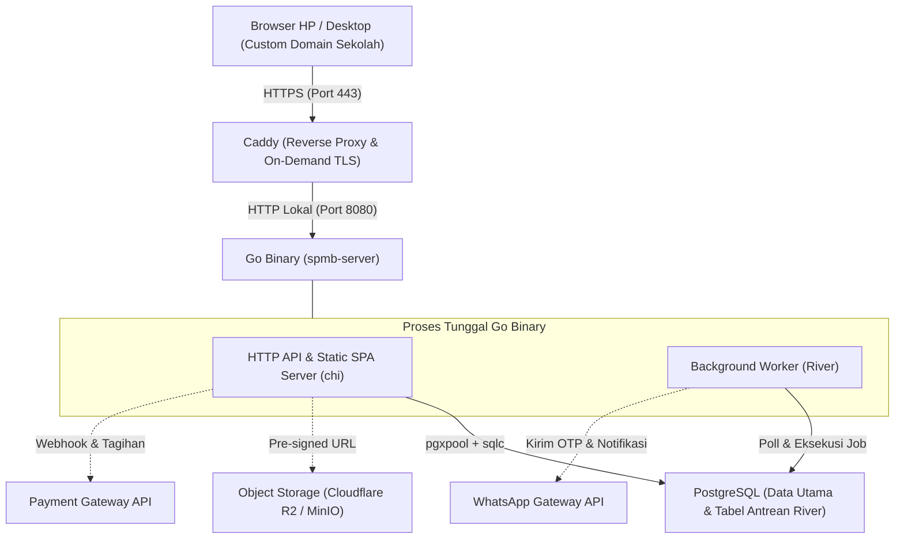

# 05. Tech Stack & Arsitektur Infrastruktur

Dokumen ini mencatat keputusan *tech stack* (**Architecture Decision Record**) yang dipilih untuk membangun platform **SPMB / PMBM / Mandiri** dengan prioritas utama: **hemat CPU & RAM, performa tinggi, alur transaksi aman, dan biaya operasional komersial yang efisien**.

---

## 1. Ringkasan Tech Stack Terpilih

| Lapisan | Teknologi | Peran & Alasan Pemilihan |
| :--- | :--- | :--- |
| **Reverse Proxy & SSL** | **Caddy** | Pintu masuk HTTP/HTTPS, kompresi respons, serta penerbitan sertifikat SSL otomatis (*On-Demand TLS*) untuk *custom domain* tiap sekolah/madrasah dengan konsumsi RAM sangat rendah. |
| **Backend & Worker** | **Go** (`chi` + `pgx` + `sqlc` + **River**) | Dikompilasi menjadi *single binary* berkecepatan tinggi, konsumsi RAM minimal, kompatibel standar `net/http`, query SQL *type-safe* tanpa *overhead* ORM, serta antrean *background job* transaksional. |
| **Database & Queue** | **PostgreSQL** | Database relasional ACID untuk integritas kuota, keuangan, *JSONB* untuk skema syarat dinamis per jalur, serta penyimpanan tabel antrean tugas **River** (tanpa wajib Redis di fase awal). |
| **Frontend** | **React (Vite + TypeScript SPA)** | Dibangun menjadi file statis (`HTML/JS/CSS`) saat *build-time*. **Tidak ada proses Node.js yang berjalan di server production.** Ekosistem UI admin/formulir sangat matang dan cepat di-maintain. |
| **Object Storage** | **S3-Compatible (Cloudflare R2 / MinIO)** | Penyimpanan privat untuk berkas sensitif (KK, Akta, KIP, Ijazah, Bukti Bayar) menggunakan *short-lived Pre-signed URL*. |

---

## 2. Topologi Runtime (Zero Node.js di Production)

Di server production (VPS), seluruh sistem cukup berjalan dalam **3 proses utama** tanpa server SSR Node.js dan tanpa broker antrean terpisah di fase MVP:



### Strategi Penyajian Frontend & Preview WhatsApp (Tanpa SSR Server)
* **Build-time:** React (Vite) dikompilasi menjadi aset statis di folder `dist/`.
* **Serve:** Aset statis dapat di-*embed* langsung ke dalam binary Go (`go:embed`) atau disajikan oleh Caddy.
* **Dynamic Meta Injection per Domain:** Ketika browser atau bot WhatsApp meminta halaman awal (`index.html`), Go memeriksa header `Host` (misal `spmb.sekolahabc.sch.id`), mengambil profil tenant dari memori/cache, lalu menyisipkan `<title>` serta meta tag OpenGraph (`og:title`, `og:description`, `og:image`) sebelum mengirim HTML. Hasilnya: link sekolah yang dibagikan di grup WhatsApp tetap tampil profesional **tanpa menjalankan Node.js SSR**.

---

## 3. Detail Teknis Tiap Komponen

### A. Backend & Background Worker (Go)
1. **`chi` (HTTP Router):**
   * 100% kompatibel dengan antarmuka standar `net/http` Go, ringan, dan bebas *vendor lock-in*.
   * Menangani rantai middleware: *Request ID*, *Real IP*, *Tenant Host Resolver*, autentikasi JWT/Cookie Session, *Rate Limiting*, serta penjagaan otorisasi RBAC.
2. **`pgx` (`pgxpool`) + `sqlc` (Data Access Layer):**
   * Query ditulis dalam SQL murni (`.sql`), lalu `sqlc` menghasilkan kode Go yang *type-safe* pada saat *compile-time*.
   * Menghindari refleksi dan overhead ORM berat, menjaga query kompleks (seperti perankingan kuota, hitung jarak koordinat, dan ekspor ribuan baris Dapodik/EMIS) tetap cepat dan hemat memori.
3. **`River` (Transactional Job Queue di atas PostgreSQL):**
   * Berjalan di dalam proses Go yang sama (*goroutine* worker pool) dan menyimpan antrean tugas di tabel PostgreSQL.
   * Mendukung **Transactional Enqueue**: perubahan status pendaftar (misalnya `REVISION_REQUIRED` atau `ACCEPTED`) dan penjadwalan kirim notifikasi WhatsApp disimpan dalam **1 transaksi DB yang sama**—mencegah kasus status berubah tetapi notifikasi gagal masuk antrean.
   * Kasus penggunaan utama: pengiriman OTP & notifikasi WhatsApp (*auto-retry*), rilis pengumuman kelulusan terjadwal, kedaluwarsa tagihan otomatis, dan pembuatan file ekspor Excel/PDF berukuran besar.
4. **Pustaka Pendukung yang Direkomendasikan (Ekosistem Go):**
   * **Migrasi Skema DB:** `goose` atau `golang-migrate`.
   * **Ekspor Excel (Dapodik/EMIS):** `excelize`.
   * **Cetak PDF (Kartu Ujian / Surat Lulus):** Generator PDF ringan di Go atau template HTML-to-PDF bila diperlukan.
   * **S3 Client:** `aws-sdk-go-v2` untuk komunikasi ke Cloudflare R2 atau MinIO.

### B. Database (PostgreSQL)
* **Isolasi Multi-Tenant:** Setiap tabel domain menyimpan `tenant_id` dengan indeks komposit (`(tenant_id, ...)`). Validasi kepemilikan tenant ditegakkan konsisten pada setiap query `sqlc` (dan dapat diperkuat dengan *Row-Level Security* bila dibutuhkan).
* **Fleksibilitas Skema Dinamis:** Memanfaatkan kolom `JSONB` secara terukur untuk menyimpan definisi *form fields* tambahan per jalur (misal detail prestasi, data asrama/pesantren, atau preferensi khusus sekolah) sementara kolom biodata standar Dapodik/EMIS tetap berupa kolom relasional terstruktur agar mudah diindeks dan diekspor.

### C. Frontend (React + Vite + TypeScript SPA)
* **Optimasi Beban Client (*Code Splitting*):**
  * Bundle aplikasi dipecah berdasarkan rute (*route-based lazy loading*) sehingga orang tua yang membuka portal pendaftaran dari HP tidak ikut mengunduh modul berat khusus dashboard panitia/keuangan.
* **Kompresi Berkas di Browser (*Client-Side Compression*):**
  * Sebelum mengunggah foto KK, Akta, atau bukti transfer, SPA melakukan kompresi & resize otomatis di sisi browser (target ukuran < 1 MB dengan keterbacaan teks tetap terjaga) lalu mengunggah langsung ke Object Storage melalui *Pre-signed Upload URL* dari Go—sehingga server Go tidak terbebani aliran upload file besar.
* **Pustaka UI & Styling yang Selaras:**
  * Styling: Custom CSS terstruktur (Design Tokens via CSS Custom Properties + CSS Modules, tanpa Tailwind CSS; fokus *Light Mode* kontras tinggi di Fase 1).
  * Ikon: SVG ringan *tree-shakeable* (`lucide-react`).
  * Peta Domisili: **Leaflet + OpenStreetMap** (di-load secara *lazy* hanya pada jalur yang membutuhkan koordinat).
  * State & Data Fetching: TanStack Query & React Router / TanStack Router.
  * Validasi Formulir Bertahap: React Hook Form + Zod (selaras dengan skema dinamis dari backend).

### D. Reverse Proxy & Custom Domain (Caddy)
* **Auto-HTTPS untuk Domain Sekolah:** Menggunakan fitur *On-Demand TLS* di Caddy.
* **Proteksi Penyalahgunaan SSL:** Caddy wajib dikonfigurasi memanggil endpoint verifikasi internal Go (misalnya `GET /internal/tls/verify?domain=...`) sebelum menerbitkan sertifikat baru, sehingga hanya domain sekolah yang sah dan terdaftar di tabel `tenants` yang diizinkan memperoleh sertifikat SSL.

---

## 4. Rencana Struktur Repositori

Untuk memudahkan pengembangan oleh solo developer maupun tim kecil, kode dapat disusun dalam struktur monorepo ringan:

```text
PBDB/
├── docs/                       # Dokumentasi produk, arsitektur & ADR
├── backend/
│   ├── cmd/
│   │   └── server/             # Entrypoint utama (API + River Worker + SPA serve)
│   ├── internal/
│   │   ├── config/             # Konfigurasi env & startup
│   │   ├── database/           # Koneksi pgxpool & hasil generate sqlc
│   │   ├── middleware/         # Tenant resolver, auth, RBAC, rate limit
│   │   ├── modules/            # Domain modules (tenant, admission, verification, payment, ranking, export)
│   │   ├── worker/             # Definisi job & handler River (WA, export, scheduler)
│   │   └── storage/            # S3/R2 pre-signed URL client
│   ├── sql/
│   │   ├── migrations/         # Skema SQL & migrasi bertahap
│   │   └── queries/            # Query SQL sumber untuk sqlc
│   ├── go.mod
│   └── sqlc.yaml
├── frontend/
│   ├── src/
│   │   ├── routes/             # Portal publik, portal pendaftar & dashboard panitia
│   │   ├── components/         # Komponen UI reusable & form dinamis
│   │   ├── lib/                # API client, kompresi gambar client-side, helper preset istilah
│   │   └── main.tsx
│   ├── package.json
│   └── vite.config.ts
└── deploy/
    ├── Caddyfile               # Konfigurasi reverse proxy & On-Demand TLS
    └── Dockerfile              # Multi-stage build (Node build frontend -> Go build binary -> Alpine/Distroless)
```

---

## 5. Strategi Deployment, Efisiensi & Skalabilitas

### Profil Resource Awal (Hemat Biaya Komersial)
Karena tidak menjalankan runtime Node.js SSR maupun broker Redis terpisah di awal:
* **1 VPS ukuran 2 vCPU / 2–4 GB RAM** sudah memadai untuk tahap peluncuran dan menampung banyak tenant sekolah sekaligus.
* Konsumsi memori Caddy + Go Binary + River Worker umumnya berada di kisaran **~60–150 MB RAM** pada beban normal, sehingga mayoritas RAM VPS dapat dialokasikan untuk *buffer* dan *cache* **PostgreSQL**.

### Jalur Skalabilitas (*Scale-Out Path*)
Jika jumlah tenant dan lonjakan trafik pengumuman sudah sangat besar:
1. **Pisah Mode Worker:** Binary Go yang sama dapat dijalankan dalam mode terpisah (`--mode=api` dan `--mode=worker`) atau *horizontal scaling* pada API server di belakang load balancer.
2. **Tambah Valkey / Redis *(Opsional Lanjutan)*:** Ditambahkan hanya jika kelak membutuhkan *distributed rate limiting* atau *shared cache* lintas banyak instance server Go.
3. **Database Scaling:** Mengaktifkan *read replica* PostgreSQL khusus untuk halaman cek status publik & ekspor laporan saat jam pengumuman puncak.

